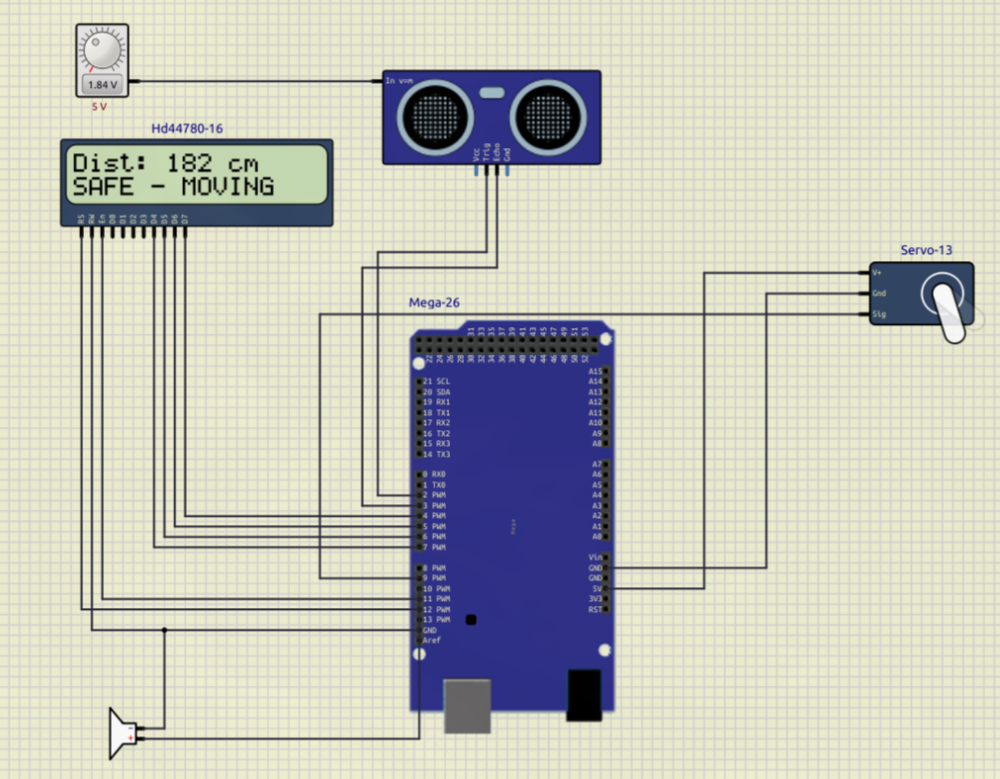
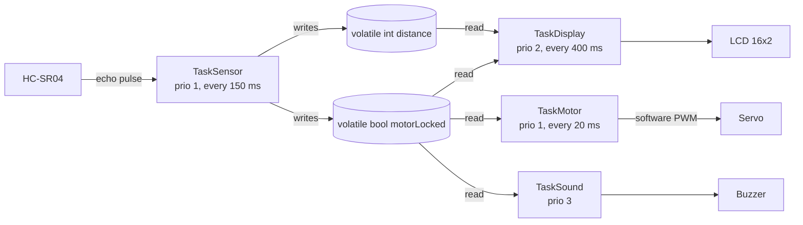

# Real-Time Obstacle Detection and Warning System

Obstacle detection on an Arduino Mega 2560 (ATmega2560) using four FreeRTOS tasks:
ultrasonic ranging, software-PWM servo sweep, 16x2 LCD status and a buzzer alarm.
Built and tested in the SimulIDE circuit simulator.



## Overview

The system watches the space in front of it with an HC-SR04 ultrasonic sensor
while a servo sweeps from 0 to 180 degrees. When something comes closer than
200 cm, the servo stops, the buzzer beeps and the LCD shows `!! TOO CLOSE !!`.
When the obstacle moves away, the sweep resumes. Each job (sensing, motor,
display, sound) runs as its own preemptive FreeRTOS task with its own priority
and stack, so a slow LCD update never blocks the alarm.

## Features

- 4 FreeRTOS tasks created with `xTaskCreate`, fixed priorities 1 to 3.
- HC-SR04 time-of-flight ranging every 150 ms with a 30 ms echo timeout.
- Servo driven by software PWM (500 to 2390 µs pulse) instead of `Servo.h`.
- LCD (HD44780, 4-bit mode) shows live distance and the system state.
- Buzzer pulses 50 ms on / 750 ms off while an obstacle is too close.
- Tuned task stacks and `F()` strings to fit the 8 KB SRAM.

## Hardware

Simulated only; it has not been run on a physical board.

| Component | Role | Pins (`src/main.cpp`) |
|---|---|---|
| Arduino Mega 2560 (ATmega2560, 16 MHz, 8 KB SRAM) | Runs FreeRTOS and all tasks | - |
| HC-SR04 ultrasonic sensor | Distance measurement | TRIG 2, ECHO 3 |
| Servo (SG90 class) | Scanning sweep, stops on alarm | Signal 9 |
| HD44780 LCD 16x2, 4-bit | Distance and status display | RS 12, E 11, D4-D7 = 7, 6, 5, 4 |
| Buzzer | Audible alarm | 10 |
| Voltage source knob 0-5 V (simulation only) | Sets the simulated distance on the sensor | - |

## Architecture



### How the FreeRTOS part works

**The scheduler.** `setup()` creates the four tasks, then calls
`vTaskStartScheduler()`. From then on FreeRTOS decides which task runs.
The rule is simple: the highest-priority task that is ready always runs.
Tasks with the same priority take turns. `loop()` is empty and never used.

**Tasks** (values from `xTaskCreate` in `setup()`):

| Task | Priority | Stack (words) | Waits with `vTaskDelay` | What it does |
|---|---|---|---|---|
| `TaskSound` | 3 (highest) | 100 | 50 ms on + 750 ms off, or 500 ms when idle | Pulses the buzzer while `motorLocked` is true |
| `TaskDisplay` | 2 | 192 | 400 ms | Prints `Dist: <n> cm` and `SAFE - MOVING` or `!! TOO CLOSE !!` |
| `TaskSensor` | 1 | 128 | 150 ms | Triggers the HC-SR04, measures the echo, sets `distance` and `motorLocked` |
| `TaskMotor` | 1 | 128 | 20 ms | Moves the servo 5 degrees per step while `motorLocked` is false |

**Why these priorities.** The alarm matters most, so `TaskSound` gets the top
priority. The display comes next. Sensing and the motor share the lowest
priority and take turns.

**Waiting without blocking.** Every task ends its loop with
`vTaskDelay(pdMS_TO_TICKS(...))`. This puts the task to sleep and gives the
CPU to the other tasks. Nothing busy-waits for hundreds of milliseconds.

**Sharing data.** The tasks do not use queues, semaphores or mutexes. They
share two `volatile` globals:
- `distance` (`int`): written by `TaskSensor`, read by `TaskDisplay`.
- `motorLocked` (`bool`): set by `TaskSensor` (`distance < 200`), read by the other three tasks.

A one-byte `bool` is read and written in a single instruction on AVR, so
`motorLocked` is safe. See Limitations for `distance`.

**Distance.** `TaskSensor` sends a 10 µs pulse on TRIG, then
`pulseIn(ECHO_PIN, HIGH, 30000)` measures the echo time in µs.
Distance in cm = `time × 0.034 / 2` (speed of sound, round trip).
If no echo returns within 30 ms, `distance` is set to 400 (nothing in range).

**Servo without `Servo.h`.** `TaskMotor` makes the servo pulse itself:
pin HIGH, `delayMicroseconds(500 + angle × 10.5)`, pin LOW, then sleep.
This maps 0 to 180 degrees to a 500 to 2390 µs pulse.
<!-- TODO(Anis): the report says Servo.h was dropped because it clashed with FreeRTOS over Timer 1.
     The Arduino_FreeRTOS port ticks from the watchdog timer by default, so that reason is unverified. Add the real reason if you find it. -->

**Memory.** The four stacks take 548 words. On an 8-bit AVR port one stack
word is one byte. The project first targeted an Arduino Uno (2 KB SRAM);
per the report, the four task stacks overflowed and the kernel crashed.
The Mega's 8 KB fixed it. All LCD strings use `F()` so they stay in flash
instead of SRAM.

## What I built vs reused

- **Built (solo):** the task design, priorities and stack sizes, the shared-state
  logic, HC-SR04 ranging code, the software-PWM servo driver, the LCD and alarm
  logic, and the SimulIDE circuit (`simulation/freeRTOS.sim1`).
- **Reused:**
  - [Arduino_FreeRTOS](https://github.com/feilipu/Arduino_FreeRTOS_Library), a FreeRTOS port for AVR.
  - [LiquidCrystal](https://github.com/arduino-libraries/LiquidCrystal), the Arduino LCD library.
  - Arduino core functions: `pulseIn`, `delayMicroseconds`, `digitalWrite`.

## Results

Tested in SimulIDE 1.1.0-SR1 by turning the voltage knob that sets the sensor
distance:
- Above 200 cm: the servo sweeps 0 to 180 degrees and the LCD shows `SAFE - MOVING`.
- Below 200 cm: the servo stops, the buzzer pulses and the LCD shows `!! TOO CLOSE !!`.
- Back above 200 cm: the sweep resumes.

TODO(Anis): no measured numbers yet. Easy ones to add:
- RAM and flash use (printed at the end of a PlatformIO build).
- Free stack per task, from `uxTaskGetStackHighWaterMark()`.

## Getting started

No hardware needed: everything runs in SimulIDE.

**Prerequisites:** [PlatformIO](https://platformio.org/) and
[SimulIDE](https://simulide.com/) (the circuit was saved with 1.1.0-SR1).

**1. Build the firmware.** The repo has no `platformio.ini` yet, so create one first.
These steps are not yet tested from a clean clone:

```bash
pio project init --board megaatmega2560
pio pkg install --library "feilipu/FreeRTOS" --library "arduino-libraries/LiquidCrystal"
pio run
```

The firmware is written to `.pio/build/megaatmega2560/firmware.hex`.

**2. Run the simulation.**
1. Open `simulation/freeRTOS.sim1` in SimulIDE.
2. Right-click the Mega, choose **Load firmware**, and select `firmware.hex`.
3. Start the simulation.
4. Turn the voltage knob next to the HC-SR04: low voltage means a close obstacle.

<!-- TODO(Anis): check the exact menu name for loading firmware in your SimulIDE version. -->

## Repository structure

```
.
├── src/main.cpp            # all firmware: setup() and the 4 FreeRTOS tasks
├── simulation/freeRTOS.sim1 # SimulIDE circuit
├── Rapport/                # project report (PDF)
├── docs/simulide.png       # simulation screenshot
└── README.md
```

## Limitations and future work

- **`distance` can be torn.** It is a 16-bit `int`, so an 8-bit AVR writes it in two steps.
  `TaskDisplay` (priority 2) can preempt `TaskSensor` between the two steps and print a wrong value.
  Fix: send readings through a FreeRTOS queue (`xQueueOverwrite` / `xQueuePeek`) or wrap the access in `taskENTER_CRITICAL()`.
- **Coarse timing.** The Arduino_FreeRTOS port uses a tick of about 15 ms by default.
  So `pdMS_TO_TICKS(20)` sleeps about one tick, and all periods are approximate.
  `vTaskDelay` also adds each task's run time to its period, so the periods drift.
  `vTaskDelayUntil` would give fixed periods.
- **Busy-waits can be preempted.** `pulseIn` (up to 30 ms) and `delayMicroseconds` spin the CPU.
  A higher-priority task waking in the middle can stretch the echo measurement or the servo pulse.
  A hardware timer (input capture for the echo, a PWM channel for the servo) would remove this.
- **Simulation only.** It has not been run on a physical Mega with real sensors.
- **No build config in the repo** (`platformio.ini` or `library.properties`).

## Context

Solo embedded systems course project at ESI Sidi Bel Abbès (Algeria),
group G2. Report submitted on 2 January 2026 (`Rapport/freeRTOS Lakhdari G2.pdf`).

Author: Lakhdari Anis Charef Eddine.

## Acknowledgements

Thanks to the authors of Arduino_FreeRTOS and LiquidCrystal.
